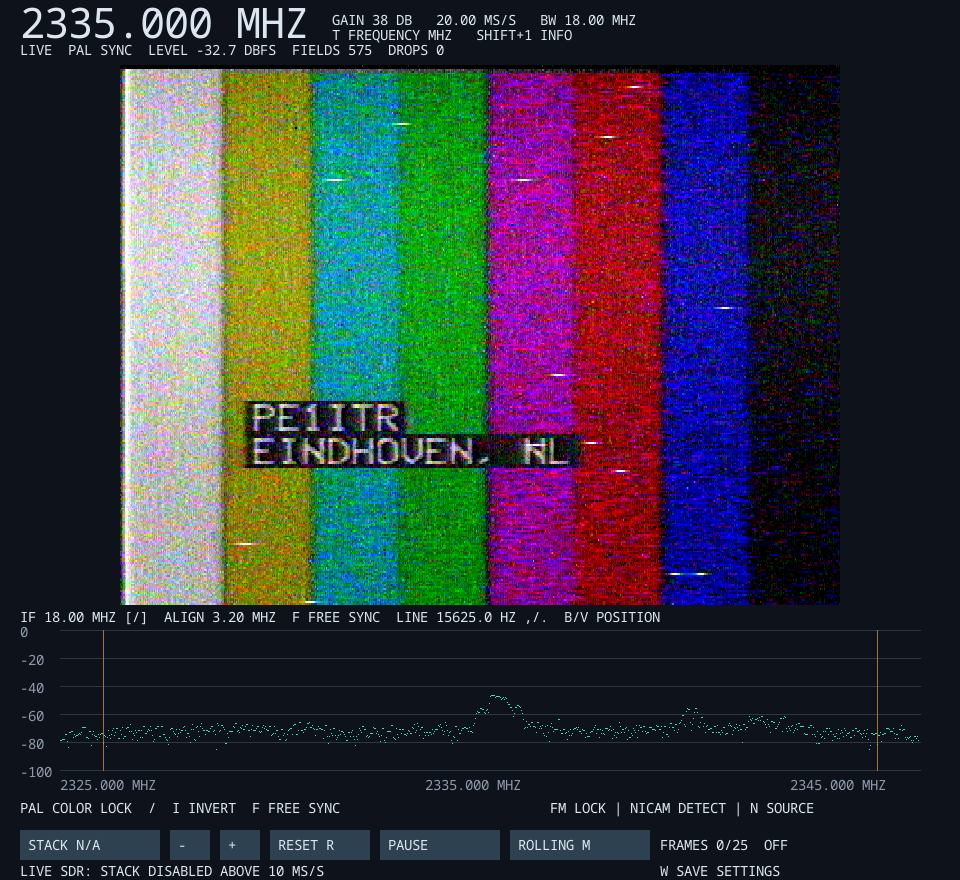

# FM-ATV receiver for Linux and Windows

A C receiver for analog FM amateur television, with PAL color, FM mono/stereo
and NICAM stereo audio on Linux and Windows. Free-running synchronization and
frame stacking help recover pictures from weak or intermittent signals. Input
can come from an SDR, a recorded IQ file or the built-in demo.



*Example reception at 2335 MHz and 20 MS/s. This screenshot shows an earlier
version of the user interface.*

The receiver supports two main uses:

- **Full picture and sound:** PAL color with FM mono, FM stereo or NICAM audio,
  provided the sample rate, bandwidth and received signal support them.
- **Weak-signal DX:** monochrome reception with free-running synchronization
  and frame stacking. Live SDR stacking is available at sample rates up to
  **10 MS/s**. The demo and IQ-file sources do not have this stacking limit.

PAL timing is 625 lines, 15,625 lines/s and 50 fields/s. Each field is displayed
as a 640 × 288 picture stretched to 4:3. The decoder does not combine two
interlaced fields into a 576-line frame.

## Quick start

### Windows

Download the ZIP from [GitHub Releases](https://github.com/pe1itr/atv-receiver-analog/releases/latest).
The package targets Windows 10 version 1903 or later and Windows 11, x64.

1. Extract the entire ZIP into a normal folder.
2. Install the USB device driver if needed; see `LEESMIJ.txt` in the package
   for the driver links. This bundled guide is currently in Dutch.
3. Run `atv-rx.exe`. Press **W + Enter** in the startup screen to configure
   reception, then choose **2** for HackRF or **3** for PlutoSDR.
4. Select the frequency, sample rate, video IF bandwidth and audio output.
5. Press **W** during reception to save settings.

Pressing **Enter** at startup uses saved settings. With no saved settings,
it starts the demo. Keep all DLLs, the `modules` folder and `font.ttf` beside
the executable. **! (Shift+1)** opens the controls screen; **Esc** exits.

The Windows package includes HackRF and PlutoSDR support. UHD/B210 is not
included. SDRplay needs additional software as described below. The package
contains the receiver and its runtime dependencies, without test programs or
IQ recordings.

### Linux

The native build requires a C11 compiler, make, pkg-config, SDL2, single-precision
FFTW3, UHD, SoapySDR, libpng, FreeType and Fontconfig development packages.
UHD and SoapySDR are required by the Linux build even when using the demo.

On Fedora 43:

```sh
sudo dnf install gcc make pkgconf-pkg-config \
  sdl2-compat-devel fftw-devel SoapySDR-devel uhd-devel \
  libpng-devel freetype-devel fontconfig-devel \
  google-noto-sans-mono-vf-fonts
make -j2
./build/atv-rx --no-config --no-wizard --demo
```

`make` builds only `build/atv-rx`. Run it without arguments to open the startup
wizard. The demo needs no SDR and does not transmit anything.

PlutoSDR support is optional and requires **libiio >= 0.23 and < 1.0**:

```sh
sudo dnf install libiio-devel
pkg-config --modversion libiio
make -B -j2
```

The Makefile detects this libiio version range automatically. libiio 1.x is
not supported by this driver. Use `make -B HAVE_LIBIIO=0` to disable Pluto
support explicitly. Rebuild with `make -B` after changing dependencies or
compiler options.

HackRF also needs the SoapyHackRF module and USB access permissions. Other
Linux distributions need equivalent development packages. The detailed
[installation guide](INSTALL.md) is currently in Dutch.

There is no `make install` target. To install the executable for your user:

```sh
install -Dm755 build/atv-rx "$HOME/.local/bin/atv-rx"
```

Shared libraries and hardware drivers must remain installed on the system.

## Hardware and bandwidth

**Best results in the project's practical reception tests were obtained with
the OpenSourceSDRLab B210 Kintex-7 model described below.** Its **USB 3.0**
connection provides more transport headroom for the high sample rates used
for full-bandwidth FM-ATV reception. Connect it to a USB 3.0 port with a
suitable USB 3.0 cable. This recommendation is based on the tested setup;
performance still depends on the host computer and configuration. B210 support
is available in the Linux build, not in the current Windows package.

| Source | Linux | Windows package |
| --- | --- | --- |
| PlutoSDR / AD9361 | Optional libiio >= 0.23 and < 1.0 | Included; USB or network |
| HackRF | SoapySDR and SoapyHackRF | Included |
| B210 / described Kintex-7 clone | UHD and matching firmware/FPGA images | Not included |
| SDRplay RSP1B | Experimental; install API and SoapySDRPlay3 separately | Experimental; install compatible API/module separately |
| IQ files and demo | Available | Available |

| Feature | Minimum sample rate | Minimum video IF bandwidth |
| --- | --- | --- |
| Automatic PAL color | 12 MS/s | 10 MHz |
| FM mono at 6 MHz | 14 MS/s | 14 MHz |
| NICAM stereo at 6.552 MHz | 14 MS/s | 14 MHz |
| FM stereo at 7.02/7.22 or 7.38/7.56 MHz | 16 MS/s | 16 MHz |

These limits enable the corresponding decoder; the transmission must contain
the required color or audio information. **20 MS/s with 16 MHz video IF** is
a starting point for color and audio. At 10 MS/s, audio decoding is disabled.

For live weak-signal reception with stacking:

| SDR | Application sample-rate range for live stacking |
| --- | --- |
| PlutoSDR | 5–10 MS/s; 5 and 6 MS/s have been used with video sync |
| HackRF and B210 | 8–10 MS/s |
| SDRplay RSP1B | 8 to strictly below 10 MS/s; not tested on real hardware |

Supported settings do not guarantee continuous throughput. The computer, SDR,
USB/network connection and signal bandwidth determine practical limits. On one
Windows laptop, HackRF reception needed 18 rather than 20 MS/s. This is a
measurement on that system, not a universal Windows limit.

### PlutoSDR / AD9361

The direct libiio driver uses RX1 (`--channel 0`), `A_BALANCED`, the internal
reference and manual receive gain. Without a URI it selects one USB AD9361
receiver. With multiple devices, specify `--pluto-uri`; `iio_info -s` lists URIs.
USB URIs may change after reconnecting.

```sh
./build/atv-rx --no-config --no-wizard --pluto \
  --frequency 1252000000 --rate 10000000 \
  --bandwidth 8000000 --if-bandwidth 6000000 --gain 30

# Network connection:
./build/atv-rx --no-config --no-wizard --pluto --pluto-uri ip:192.168.2.1 \
  --frequency 1252000000 --rate 6000000 \
  --bandwidth 5000000 --if-bandwidth 5000000 --gain 30
```

The default receive block is 131072 samples, based on practical USB tests.
At 10 MS/s, 16-bit I/Q requires 40 MB/s before transport overhead; continuous
operation depends on the connection. Lower sample rates reduce this load.
Hardware and firmware determine the available frequency range. The receiver
does not modify device firmware.

### HackRF

```sh
./build/atv-rx --no-config --no-wizard --hackrf \
  --frequency 1252000000 --rate 20000000 \
  --bandwidth 18000000 --if-bandwidth 16000000 --gain 24
```

The gain control adjusts **RX LNA only**, from 0 to 40 dB in 8 dB steps.
RX VGA defaults to a fixed 28 dB; the RF amplifier remains enabled
(nominally 14 dB). Set VGA separately with `--hackrf-vga`, from 0 to 62 dB
in 2 dB steps. The interface labels the adjustable gain as `LNA`.

Older configurations used total gain; those values are not directly
comparable. Values are rounded/clamped to the supported LNA settings.
Check clipping and reception quality after changing gain.

### B210 and the OpenSourceSDRLab Kintex-7 clone

The UHD driver uses channel 0 and antenna `TX/RX` by default, corresponding
to the TRX1 port. Only a receive stream is opened.

```sh
./build/atv-rx --no-config --no-wizard --b210 \
  --frequency 1252000000 --rate 20000000 \
  --bandwidth 18000000 --if-bandwidth 16000000 --gain 30 \
  --uhd-images-dir /path/to/matching-images
```

Provide firmware/FPGA images matching your hardware. The Kintex-7 clone needs
different images from a standard Ettus B210. The receiver checks for readable
`usrp_b210_fpga.bin` and `usrp_b200_fw.hex`, then sets `UHD_IMAGES_DIR` before
opening UHD. It does not verify image compatibility or fall back to system
images. The default directory is `uhd-images/` relative to the working directory;
firmware is not included in this repository.

Use `--args 'serial=YOUR_SERIAL'` to select a device and `--ref external` for
an external reference.

### SDRplay RSP1B (experimental)

This integration has **not been tested with a physical RSP1B**. Install the
[SDRplay hardware API](https://sdrplay.com/hardware-api/) (3.15 or later) and
[SoapySDRPlay3](https://github.com/pothosware/SoapySDRPlay3) with RSP1B support.
The API, USB driver and Soapy module are separate installations.

The application accepts **8 MS/s to strictly below 10 MS/s**, with at most
**8 MHz analog bandwidth**. This enables monochrome reception and stacking;
PAL color and audio decoding require higher rates. A wide FM-ATV signal may
be distorted by the available bandwidth. The RSP1B tuning range is 1 kHz–2 GHz,
so 2.3 GHz reception requires a converter.

```sh
./build/atv-rx --no-config --no-wizard --sdrplay \
  --frequency 1252000000 --rate 8000000 \
  --bandwidth 8000000 --if-bandwidth 8000000 --gain 30
```

Gain controls 0–39 dB above minimum IF gain (`IFGR = 59 - gain`), with AGC off
and RF/LNA state 0. This is not calibrated total RF gain. Use `--args serial=...`
with multiple receivers. On Windows the module must match x64, SoapySDR ABI 0.8
and the package's MinGW build; place it in `modules` with its dependencies
available. The standard ZIP does not bundle this module.

## Configuration

At startup, **W + Enter** enters the wizard; **Enter** uses the current settings.
The hardware choices are 1 B210, 2 HackRF, 3 PlutoSDR and 4 SDRplay RSP1B.
`Installed` indicates available driver support, not a connected or verified SDR.

Frequencies and bandwidths in the wizard and command line are in Hz. The wizard
selects analog bandwidth as sample rate minus 1 MHz below 8 MS/s, or minus
2 MHz at higher rates. Digital video IF bandwidth is a separate setting. The
sync/alignment path defaults to 3.2 MHz. Actual device settings are read back
from the driver.

Default receive blocks are 16384 samples for B210, 131072 for Pluto and 32768
for other sources. `--rx-block N` accepts 2048–1048576 samples. Larger blocks
reduce per-transfer overhead but increase buffering latency.

Press **W** during reception to save the complete current configuration:

- Linux: `~/.atv-rx.conf`
- Windows: `%APPDATA%\PE1ITR\ATV Receiver\atv-rx.conf`

Command-line options override saved settings; subsequent wizard changes take
precedence. The wizard does not save automatically. AFC starts disabled.

```sh
./build/atv-rx --no-wizard
./build/atv-rx --no-config
./build/atv-rx --config my-radio.conf
./build/atv-rx --no-config --config my-radio.conf
./build/atv-rx --version
```

The Windows wizard also selects the audio device; 0 uses the system default.
Device names are saved, rather than list positions. An unavailable saved output
falls back to the system default and is reported in `atv-rx.log` beside the
Windows configuration file. This log is replaced on each start.

### Frequency converters

`--frequency` is the displayed frequency before the converter. The SDR tunes
to `frequency - lo`. For example, this displays 2335 MHz and tunes the HackRF
to 1435 MHz:

```sh
./build/atv-rx --no-config --no-wizard --hackrf \
  --frequency 2335000000 --lo 900000000 --rate 18000000 \
  --bandwidth 16000000 --if-bandwidth 16000000 --gain 24
```

The resulting SDR frequency must be within the device's limits. This option
does not compensate for spectral inversion introduced by a converter.

## Controls

| Control | Action |
| --- | --- |
| Left/right arrows or mouse wheel | Tune in 100 kHz steps |
| Shift + tuning | Tune in 1 MHz steps |
| Ctrl + tuning | Tune in 10 kHz steps |
| Click spectrum | Tune the selected frequency to the center |
| `T` | Enter frequency directly in MHz; Enter confirms, Esc cancels |
| `W` | Save current settings |
| `!` / Shift+1 | Show controls and version; reception pauses until dismissed |
| Up/down arrows | Adjust gain; HackRF uses 8 dB LNA steps |
| `[` / `]` | Decrease/increase digital video IF by 1 MHz |
| `C` / AFC button | Toggle automatic fine tuning for live SDR input |
| `F` | Switch received/free-running synchronization |
| `,` / `.` | Adjust free-running line frequency by 0.1 Hz |
| `B` / `V` | Shift vertical position by one line in free-running mode |
| `I` | Invert FM video polarity |
| `D` | Switch FM0/FM1 demodulation |
| `A` | Mute/unmute audio |
| `N` | Cycle FM mono, NICAM and the two FM stereo pairs |
| Shift+N | Swap left/right for FM stereo |
| `S` / stack button | Enable/disable frame stacking |
| `M` / FIXED/ROLLING | Switch stacking mode and restart the stack |
| `-` / `+` | Change stack size, 1–512 fields |
| `R` / Reset | Clear the stack |
| `P` | Save a PNG screenshot of the full window |
| Shift+P / Pause | Pause/resume stacking while keeping the result |
| Esc | Exit |

Screenshots are saved in the working directory with frequency and UTC time
in the filename. `--snapshot PATH` also supports saving a BMP on exit.

### AFC and FM detector selection

AFC uses recognizable PAL synchronization and the back-porch black level to
estimate tuning error. It is limited to ±500 kHz around the manual tuning
anchor. `SEEK` means no reliable estimate, `TRACK` means tracking, and `LIMIT`
means the requested correction exceeds that range. This range is not a
universal acquisition guarantee. Correct polarity and de-emphasis are needed.

Manual tuning moves the anchor. Disabling AFC keeps the last tuned frequency;
**W** saves that frequency. AFC is unavailable for the demo and IQ files.

**FM0** is the conventional phase discriminator and the starting point for
color and detail. **FM1** uses an 8-point FFT phase detector and may help weak
signals with a narrow IF, but can affect detail, color and audio and costs
more CPU. **D** changes both the video and alignment paths and resets their
history and stack. Compare at the same frequency and bandwidth; there is no
universally optimal mode.

## Weak-signal reception and stacking

Stacking averages accepted, aligned field pictures to reduce noise. With
reliable sync, received raster timing determines alignment. Without reliable
sync, image matching is used while the raster clock continues running.
Incomplete or unreliable pictures are rejected. `HOLD` preserves the current
result while waiting for usable fields; `SKIP` counts pictures skipped by a
busy stacking worker, while `DROPS` counts discontinuities in the IQ stream.

- **FIXED:** accumulate the requested number of fields, then freeze at `DONE`.
- **ROLLING:** average the latest N accepted fields, replacing the oldest one
  with each new accepted field. Rejected fields and pauses do not advance it.

Use **R** to reset, **M** to change mode, and **Shift+P** to pause/resume.
Changing the rolling window size starts a new stack. Live SDR stacking is
limited to **10 MS/s**; higher rates display live video without stacking.

The separate sync/alignment IF defaults to 3.2 MHz. `--alignment-bandwidth 0`
uses the video IF for both paths. The `[` and `]` controls change only the
video IF. A narrower alignment path can help synchronization but also changes
signal distortion and processing load.

## Audio and video de-emphasis

**N** selects FM mono at 6 MHz, NICAM at 6.552 MHz, FM stereo at 7.02/7.22 MHz,
or FM stereo at 7.38/7.56 MHz, subject to the rate and IF limits above.
**A** mutes the selected source; there is no automatic source switching.
FM mono is played through both speakers. **Shift+N** swaps FM stereo channels.

NICAM `DETECT` indicates energy near the subcarrier, not confirmed digital
synchronization. Select NICAM to start decoding: `SEEK` means acquisition,
and `LOCK` requires validated frames. The decoder currently supports stereo;
missing lock and damaged frames produce silence. `--nicam` selects NICAM at
startup when the bandwidth and sample rate permit it. No detection is expected
when the transmitter does not send NICAM.

The integrated NICAM decoder produces 32 kHz stereo with J.17 de-emphasis;
SDL converts to the shared 48 kHz output. Audio processing uses separate
threads and bounded queues. Buffering absorbs short scheduling delays but
cannot recover from sustained overload or lost IQ samples.

The video path defaults to linear-phase **ITU-R F.405-1 PAL de-emphasis**.
Use `--video-deemphasis off` for flat signals without transmitter pre-emphasis,
including the offline generator's test signals. `--video-deemphasis pal`
selects the default explicitly. Audio is taken before video de-emphasis.

## IQ playback and recording

IQ files contain interleaved native float32 I,Q samples without a header.
Supply the correct sample rate and modulation settings:

```sh
./build/atv-rx --no-config --no-wizard --file captures/recording.cf32 \
  --rate 20000000 --deviation 4000000
```

Tuning and gain do not change samples during file playback or the demo.
IF filtering, polarity and synchronization settings still apply.

To capture a short live sample, add these options to a hardware command:

```text
--record captures/recording.cf32 --record-seconds 3 --seconds 5
```

Create the output directory first. Recording stores raw IQ before digital IF
filtering in memory and writes it on exit, without overwriting an existing
file. A discontinuity or tuning/gain change restarts collection. Limits are
15 seconds and 2 GiB, whichever is reached first. Three seconds at 10 MS/s
uses about 240 MB. Save the reception settings separately: no metadata is
embedded in the IQ file.

## Read-only status interface

The optional HTTP status interface is disabled by default. Enable it with:

```sh
./build/atv-rx --no-wizard --status-server --status-bind 127.0.0.1 --status-port 8765
python3 scripts/read-status.py 127.0.0.1 --port 8765 --once
```

Use the receiver's LAN address or `0.0.0.0` as the bind address to allow remote
clients. The interface has no authentication or TLS; use it on a trusted
network. `--no-status-server` overrides a saved enabled setting. **W** saves
the status settings; changes to bind address, port or enablement apply at the
next start.

```sh
python3 scripts/read-status.py 192.168.1.50 --port 8765 --interval 1
curl http://192.168.1.50:8765/status
```

The Python client uses only the standard library. `GET /status` reports build
information, timestamps, receiver settings, video and audio state, AFC,
stacking, receive queues and quality diagnostics.

### Interpreting measurements

- `video.if_signal_dbfs` is total IQ power **after the video IF filter and
  before FM demodulation**: signal plus noise in dBFS, not dBm or C/N.
  `video.signal_dbfs` is the wideband level before that filter.
- `video_quality.video_snr_db` is an unweighted diagnostic PAL estimate after
  FM and the selected filtering/de-emphasis. Use it only when `valid` is true;
  otherwise inspect `reason`. A missing value is not zero dB.
- Video-SNR estimates black-to-white amplitude as 7/3 of sync depth and noise
  from the flat end of the back porch, outside the color burst. It depends on
  valid sync and enough usable lines, and is not a calibrated RF measurement.
- Sync lock, color enabled and color lock are distinct states. Lack of color
  lock does not mean the picture lacks synchronization.
- Check `build_utc`, metric ages, quality validity and pause/end/error state
  before comparing snapshots.
- Discontinuities, discarded samples and hardware overflows are cumulative.
  Compare their increases over the timestamp interval; decreasing counters
  can indicate a restart or reset.
- Current queue latency is `1000 * queued_samples / sample_rate_sps` in ms.
  A historical peak does not describe current buffer occupancy.

Bandwidth, gain, detector mode and de-emphasis changes alter measurement
conditions. A single snapshot cannot establish a cause or an optimal setting.
Digital clipping diagnostics indicate sample saturation; they do not detect
all possible analog overload earlier in the receive chain.

## Building the Windows package

The supported cross-build uses Fedora and MinGW-w64, not MSVC. It downloads
pinned dependency versions, verifies SHA-256 checksums, builds the receiver
and collects its DLL dependencies and license notices.

```sh
sudo dnf install make cmake pkgconf-pkg-config curl python3 tar gzip \
  mingw64-gcc mingw64-gcc-c++ mingw64-binutils \
  mingw64-fftw mingw64-freetype mingw64-libpng mingw64-libxml2 \
  mingw64-libusb1 mingw64-bzip2 mingw64-zlib mingw64-win-iconv \
  mingw64-winpthreads mingw64-libstdc++ \
  freetype google-noto-fonts-common google-noto-sans-mono-vf-fonts
make windows
```

Python 3.12 or newer is required. The packaging scripts use Fedora package and
license paths. Outputs are under `build/windows/`:

- `atv-receiver-windows-x64.zip`
- `atv-receiver-windows-x64.zip.sha256`
- `atv-receiver-windows-x64/` — extracted distribution
- `BUILD-INFO.txt` — dependency/build information, outside the ZIP

FFTW is built with SSE2 acceleration for x64; AVX is not required. DLL imports
are checked recursively, and packaging fails on unresolved dependencies.
A successful build or Wine smoke test does not replace reception testing on
a Windows computer with actual SDR hardware.

## Repository contents

| Path | Contents |
| --- | --- |
| `src/` | Receiver, DSP and optional offline signal/evaluation tools |
| `src/nicam_core/` | Integrated NICAM decoder, origin and its license |
| `scripts/` | Build, packaging, status and analysis scripts |
| `docs/images/` | The selected README example image |
| `INSTALL.md` | Detailed installation guide in Dutch |

`build/`, `tests/`, personal notes, recordings and generated screenshots are
excluded from the public repository. The selected README image is the only
screenshot included. Use `captures/` for recordings and `measurements/` or
`build/` for analysis output; these directories are ignored by Git.

`make` builds only the receiver. `make tools` optionally builds `atv-tx`
(an offline IQ generator; it does not transmit) and `atv-eval` (an offline
DSP evaluator). Automated test and benchmark targets require the local
`tests/` sources, which are not distributed in this repository. The receiver,
demo and Windows package build without them.

## License status

A project-wide license has not yet been specified. The integrated NICAM code
has its own [Apache-2.0 license](src/nicam_core/LICENSE) and
[origin/change notes](src/nicam_core/ORIGIN.txt); that license does not
automatically apply to the rest of the project. The Windows package includes
license notices for its bundled dependencies.
